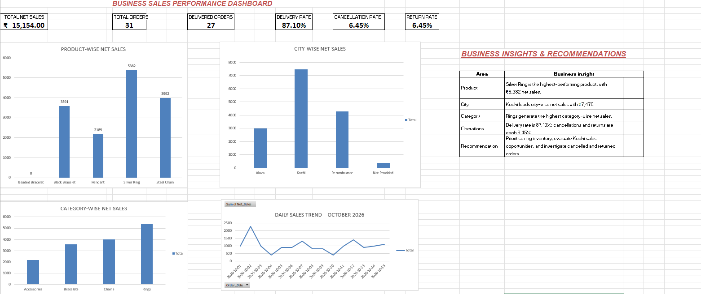

# 📊 Business Sales Performance Analysis

### Excel-Based Business Analyst Portfolio Project

A practical business analysis case study using Microsoft Excel to analyse retail sales data, identify business trends, and generate actionable insights.

## 🎯 Project Overview

This project focuses on analysing a simulated retail sales dataset to understand product performance, city-wise sales, order status, payment methods, and daily sales trends.

## 🛠️ Tools & Technologies

- Microsoft Excel
- Data Cleaning
- Excel Formulas
- PivotTables
- PivotCharts
- Data Visualization
- Business Analysis

## 📌 Key Performance Indicators

| KPI | Result |
|---|---:|
| Total Orders | 31 |
| Total Net Sales | ₹15,154 |
| Delivered Orders | 27 |
| Delivery Rate | 87.10% |
| Cancellation Rate | 6.45% |
| Return Rate | 6.45% |

## 📈 Key Business Findings

- Silver Ring generated the highest product-wise net sales (₹5,382).
- Kochi recorded the highest city-wise net sales (₹7,478).
- Rings was the top-performing category.
- October 2 recorded the highest daily sales (₹2,293).
- October 10 recorded the lowest daily sales (₹398).

## 🧹 Data Cleaning

- Removed one duplicate record.
- Identified missing Quantity and City values.
- Standardized inconsistent text and formatting.
- Created Gross Order Value and Net Sales calculations.

## 📊 Dashboard & Analysis

The Excel dashboard includes:

- Product-wise Net Sales
- City-wise Net Sales
- Category-wise Net Sales
- Daily Sales Trend
- Business Insights and Recommendations

## 📂 Project Files

- `Excel_Assignment_01_Sales_Analysis.xlsx` – Excel workbook containing cleaned data, PivotTables, charts, and dashboard.
- `Business_Sales_Performance_Analysis_Report.pdf` – Detailed business analysis report.

## 💡 Skills Demonstrated

- Data Cleaning and Preparation
- Exploratory Data Analysis
- KPI Analysis
- Data Visualization
- Business Insights Generation
- Analytical Thinking
- Business Reporting

## ⚠️ Dataset Limitations

This is a simulated dataset containing 31 cleaned records covering October 1–15, 2026. One Quantity value and one City value are missing. Profitability cannot be calculated because product costs and operating expenses were not provided.

## 👨‍💻 Author

**Aadhil Rafeek**

GitHub: [@aadhilv10](https://github.com/aadhilv10)

---

*This project was developed as part of my practical journey in Business Analytics and Data Analysis.*
